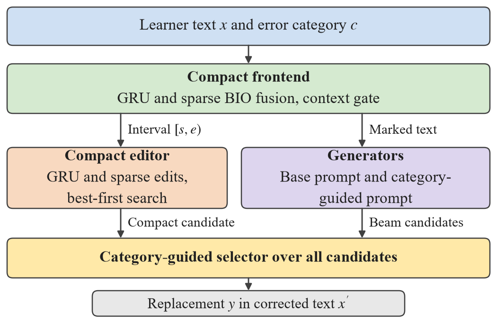

# Category-Guided Candidate Selection for Japanese Grammatical Error Correction

Code, model weights, and numerical results for the letter **"Category-Guided Candidate Selection for Japanese
Grammatical Error Correction"** by Yan Li and Xubo Fang.

[Project page](https://yanlibengbu.github.io/category-guided-selection/) · [Model weights (release v1.0.0)](https://github.com/YanLiBengbu/category-guided-selection/releases/tag/v1.0.0) ·
[Numerical results](results/) · [CAMC-JL metadata](data/)



## Highlights

- A compact frontend fixes one error interval of the requested category. A compact editor and two LoRA-adapted
  Qwen3-4B generators propose replacements for that interval, and a conditional logit selector chooses one of them.
- One generator receives the base prompt. The other receives a category guidance sentence and four retrieved
  development corrections of the same category.
- On the 559 CAMC-JL test examples, selection raised ExactMatch from 30.71% with the top-beam rule of the base
  generator to 41.74%, on par with 40.61% for the strongest of fifteen hosted LLM runs, with 4-bit base models
  on a 6 GB laptop GPU.

## Results

CAMC-JL test set, 559 examples; neural systems average three seed pipelines.

| System | SpanMatch | ExactMatch |
|---|---:|---:|
| Category-guided selection | 76.45 | **41.74** |
| Two generators, mean likelihood only | 76.45 | 35.78 |
| Auxiliary 4B, top-beam rule (BF16) | 76.45 | 33.04 |
| Guided generator, top-beam rule (4-bit) | 76.45 | 31.96 |
| Base generator, top-beam rule (4-bit) | 76.45 | 30.71 |
| Evidence-gated LGR-MAS, Qwen3.7 Max (hosted) | 57.78 | 40.61 |
| Fine-tuned Japanese T5 | 62.55 | 17.83 |
| LGR-MAS, local Qwen3-4B | 21.11 | 10.91 |
| DeBERTa localizer with the base generator | 22.06 | 10.55 |

All six metrics, the paired source-unit cluster-bootstrap intervals, the ablations, and the control generators
are in [`results/`](results/).

## Models

| Component | Files |
|---|---|
| Compact frontend | [`frontend/`](frontend/): code and manifest; the GRU, sparse, and gate files are release assets |
| Auxiliary stage | `weights/auxiliary_stage`: adapter after 1,000 updates on 16,000 simulated error pairs |
| Base generator | `weights/base_generator/seed*`: base prompt, three seeds |
| Guided generator | `weights/guided_generator/seed*`: category guidance and four demonstrations, three seeds |
| Control generators | `weights/control_*/seed*`: second base generator, guided prompt without demonstrations, and guided prompt without the guidance sentence |
| Selector | `weights/selector/`: frozen configuration (`selector_final.json`) and fitted weights (`final_selector_weights.json`) |

The adapters use rank 8 on `Qwen/Qwen3-4B-Instruct-2507` at revision `cdbee75f17c01a7cc42f958dc650907174af0554`.

## Installation

```bash
git clone https://github.com/YanLiBengbu/category-guided-selection.git
cd category-guided-selection
pip install numpy torch==2.11.0 transformers==5.19.0 peft==0.21.2 bitsandbytes==0.50.2
```

The experiments used Python 3.12.

## Pretrained models

```bash
python scripts/download_weights.py
```

The script downloads the 21 release assets listed in [`WEIGHTS.json`](WEIGHTS.json) to their destinations and
checks each SHA-256. Base models are read from `$JGEC_MODELS` (default `./models`): `qwen3_4b_instruct_2507`
(Qwen/Qwen3-4B-Instruct-2507), `sarashina2_2_3b_instruct` (sbintuitions/sarashina2.2-3b-instruct-v0.1), and, for
the baselines, `t5_base_long_japanese` (retrieva-jp/t5-base-long) and `deberta_v2_base_japanese_char_wwm`
(ku-nlp/deberta-v2-base-japanese-char-wwm).

## Quick start

```bash
cd frontend
python predict.py --list-error-types
python predict.py --text '日本語の入力文章' --error-type tense
```

## Data

The learner texts, reference corrections, and generated candidates are not redistributed. [`data/`](data/)
holds the CAMC-JL metadata: release IDs, splits, sources, error categories, development folds, grouping keys, and
test subsets. The scripts expect the CAMC-JL development and test files (`data/dev.jsonl`, `data/test.jsonl`), the
frontend intervals (`data/orig4b/inputs.jsonl`, `data/orig4b_test/inputs.jsonl`), and the auxiliary pairs, which
can be rebuilt from the Natane and ICJS/TUFS learner corpora and the simulated error pairs of Kimn et al.
(https://doi.org/10.5281/zenodo.4276130). The release IDs (`CAMCJL-T-0001` to `CAMCJL-T-0559`) align the
per-example results with the metadata. The per-example scores of the hosted prompted systems come from the
[CAMC-JL public research release](https://github.com/YanLiBengbu/CAMC-JL-public).

## Training and evaluation

The local LGR-MAS baseline needs `$LGR_MAS_SRC` to point to the `src/` folder of the LGR-MAS code.

```bash
cd code
# learner stage of both generators: out-of-fold development pools, then final refits on all development data
python cv_source.py --tag orig_k0 --style original --k 0
python cv_source.py --tag guided_k4 --style guided --k 4
python final_test.py --tag orig_k0 --style original --k 0
python final_test.py --tag guided_k4 --style guided --k 4
# score the pooled candidates under both generators and the two base language models
python cross_score.py dev ../results/cv_cross3.jsonl --score cv/orig_k0 cv/guided_k4
python cross_score.py test ../results/test_cross2_q3.jsonl --score final/orig_k0 final/guided_k4
python lm_score.py ../results/test_cross2_q3.jsonl ../results/test_cross2_lm1.jsonl qwen3
python lm_score.py ../results/test_cross2_lm1.jsonl ../results/test_cross2_lm2.jsonl sarashina
# (same two lm_score calls for the development file)
# fit the selector on development pools, apply it once to the test pools, report
cp ../weights/selector/selector_final.json ../results/
python apply_rerank_test.py ../results/selector_final.json ../results/final_selector
python ablation.py ../results/selector_final.json ../results/ablation.json
python report_test.py ../results/final_selector_matrix.npy
# controls and external baselines
bash queue9.sh && python controls_eval.py
python ext_baselines.py t5 && python ext_baselines.py deberta
python local_llm_baselines.py lgr qwen3
```

The selection experiments ran with 4-bit NormalFloat base models on one 6 GB GPU. `queue8.sh`, `queue9.sh`, and
`queue10.sh` record the order of the runs.

## Directory

| Path | Contents |
|---|---|
| `code/` | Generator training, candidate generation, cross-scoring, fluency scoring, selection, ablation, controls, external baselines, and tables |
| `frontend/` | Compact frontend: character GRUs, sparse localizers, crop localizer, and context gate |
| `weights/` | Adapter configurations and the selector; adapter tensors are release assets |
| `results/` | Means, intervals, ablations, controls, pool coverage, and seed-averaged per-example metrics |
| `data/` | CAMC-JL metadata |
| `docs/` | Project page |
| `scripts/` | Weight download |
| `WEIGHTS.json`, `SHA256SUMS.txt` | Release assets and checksums of the repository files |

## Citation

```bibtex
@misc{li2026categoryguided,
  author = {Yan Li and Xubo Fang},
  title  = {Category-Guided Candidate Selection for Japanese Grammatical Error Correction},
  year   = {2026},
  note   = {Manuscript. Code and weights: https://github.com/YanLiBengbu/category-guided-selection, release v1.0.0}
}
```

## License

Code: MIT ([`LICENSE`](LICENSE)). Model weights: Apache 2.0 ([`LICENSE-WEIGHTS`](LICENSE-WEIGHTS)); the Qwen3 base
model is obtained separately under its own license. CAMC-JL metadata, numerical results, and figures: CC BY 4.0
([`DATA_LICENSE.md`](DATA_LICENSE.md)).
